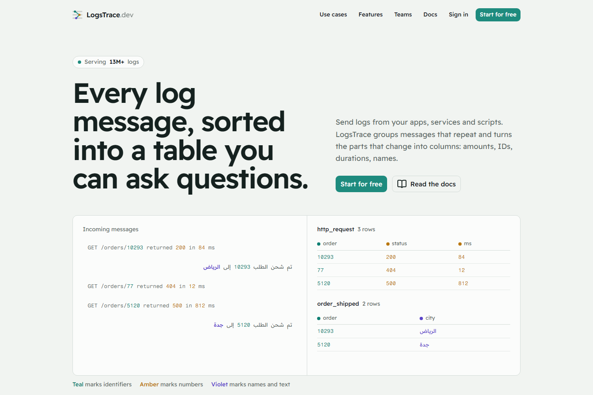
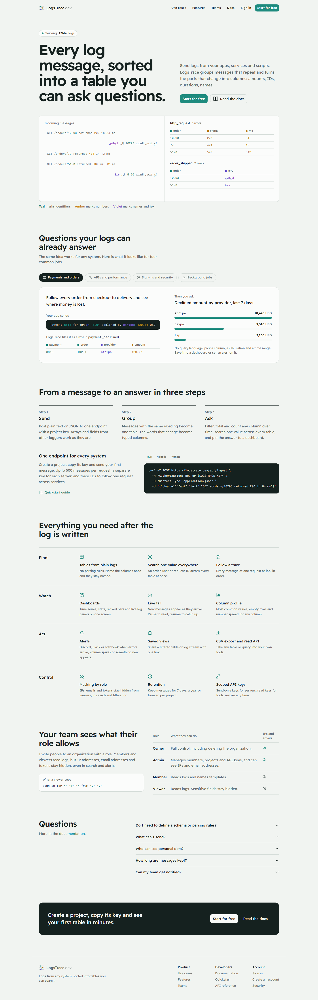

<p align="center">
  <picture>
    <source media="(prefers-color-scheme: dark)" srcset="docs/images/logo-dark.svg">
    
  </picture>
</p>

<p align="center">
  <b>Logging infrastructure for any app, service or script.</b><br>
  Send events to one endpoint. Get tables, columns, search, alerts and dashboards automatically.
</p>

<p align="center">
  <a href="https://logstrace.dev">Website</a> ·
  <a href="https://docs.logstrace.dev">Docs</a> ·
  <a href="docs/SELF_HOSTING.md">Self-hosting</a> ·
  <a href="CONTRIBUTING.md">Contributing</a>
</p>

<p align="center">
  <a href="https://skillicons.dev"></a>
</p>

<p align="center">
  <a href="LICENSE"></a>
  
  
  
  <a href="https://github.com/ifaisal-swe/LogsTrace-dev/actions/workflows/ci.yml"></a>
</p>

<p align="center">
  <a href="https://logstrace.dev"></a>
</p>

<details>
<summary><b>See the full tour</b> (use cases, features, roles)</summary>
<br>
<p align="center">
  
</p>
</details>

## Why LogsTrace

Most log tools give you a wall of text. LogsTrace turns logs into **tables you can query**:

- **Structured events** (recommended): `{ "event": "order.paid", "orderId": "10293", "amount": 49.9 }` → one table per event, one column per key.
- **Plain messages** work too: repeated messages are grouped into tables, and the words that change become columns you can rename.
- **Explore**: filter, summarise, export and trace any value (a user id, an order id) across every table.
- **Live**: real-time dashboard over Socket.IO.
- **Alerts**: volume and "text contains" alerts to Slack, Discord or webhooks.
- **Teams**: organisations, projects, roles, invites, 2FA, audit log.
- **Privacy**: sensitive values (emails, IPs, phones, secrets) are masked for users without `logs:read_sensitive`.
- **AI (optional)**: build dashboards from a description, ask questions in plain language, and connect Claude/Cursor through the built-in MCP endpoint.

## Send a log

```bash
curl -X POST https://your-domain/api/ingest \
  -H "Authorization: Bearer lgk_..." -H "Content-Type: application/json" \
  -d '{"channel":"orders","event":"order.paid","orderId":"10293","amount":49.90,"currency":"USD","method":"card"}'
```

Any language that can make an HTTP request works. See the [API reference](docs/API.md).

## Quick start (local)

Requirements: **Node 24**, **Docker**, Git.

```bash
git clone https://github.com/ifaisal-swe/LogsTrace-dev.git
cd LogsTrace-dev
cp .env.example .env     # fill in the passwords (see below)
npm install
npm run db:up            # Postgres 18 on 127.0.0.1:5432
npm run ch:up            # ClickHouse on 127.0.0.1:8123
npm run dev              # http://localhost:3000 (migrations run on startup)
```

In `.env`, set three values (generate each with `openssl rand -hex 32`):

```env
POSTGRES_PASSWORD=<random>
NUXT_DATABASE_URL=postgres://logstrace:<same password>@localhost:5432/logstrace
CLICKHOUSE_PASSWORD=<random>
NUXT_CLICKHOUSE_PASSWORD=<same as CLICKHOUSE_PASSWORD>
```

Then register at `http://localhost:3000`, create an organisation and a project, and copy an API key.

- Platform admin: set `NUXT_BOOTSTRAP_ADMIN_EMAIL` before registering, or run `npm run admin:create -- you@example.com`.
- API key from the terminal: `npm run key:create -- <org-slug> <project-slug> "Key name"`. The key is printed once; only its sha256 hash is stored.
- Without `NUXT_RESEND_API_KEY`, development prints every email (codes, resets, invites) to the server console.

Production deployment (Docker, TLS, backups, updates): **[docs/SELF_HOSTING.md](docs/SELF_HOSTING.md)**.

## Stack

Nuxt 4.5.2 · Nuxt UI 4 · Drizzle ORM · PostgreSQL 18 (accounts, settings) · ClickHouse (log events) · Socket.IO · nuxt-security.

## Environment variables

| Variable | Default | Purpose |
|---|---|---|
| `POSTGRES_USER` / `POSTGRES_PASSWORD` / `POSTGRES_DB` / `POSTGRES_PORT` | `logstrace` / required / `logstrace` / `5432` | Docker Postgres |
| `NUXT_DATABASE_URL` | — | Postgres connection string |
| `CLICKHOUSE_PASSWORD` | required | Password for the Docker ClickHouse user `logstrace` |
| `NUXT_CLICKHOUSE_URL` | empty | **Required.** ClickHouse HTTP(S) URL; all log messages are stored there. Docker compose uses the bundled one |
| `NUXT_CLICKHOUSE_USER` / `_PASSWORD` / `_DATABASE` | `default` / empty / `logstrace` | ClickHouse login; use a user limited to that database |
| `NUXT_TRUSTED_IP_HEADER` | empty | Header your proxy sets with the real client IP (`cf-connecting-ip` behind Cloudflare, `x-real-ip`). Empty: last `X-Forwarded-For` hop. Used for rate limits and audit IPs |
| `NUXT_APP_URL` | `http://localhost:3000` | Public origin. In production, the only origin allowed for cookie writes and the live socket |
| `NUXT_SECRET_KEY` | empty | Encrypts two-step sign-in secrets. Required in production; never change it once users enabled 2FA |
| `NUXT_BOOTSTRAP_ADMIN_EMAIL` | empty | This email becomes platform admin (while none exists) and can always register |
| `NUXT_OWNER_EMAILS` | empty | Comma list of verified accounts that can open the owner dashboard (`/app/admin`) |
| `NUXT_REQUIRE_EMAIL_VERIFICATION` | `false` (compose: `true`) | Users must enter the emailed code before using orgs |
| `NUXT_PUBLIC_REGISTRATION` | `open` | `open` \| `invite` \| `closed` |
| `NUXT_PUBLIC_APP_NAME` | `LogsTrace` | Product name shown in the UI and emails |
| `NUXT_RESEND_API_KEY` | empty | Resend API key for all email. Required in production |
| `NUXT_MAIL_FROM` | `LogsTrace <no-reply@logstrace.dev>` | Sender; the domain must be verified in Resend |
| `NUXT_MAIL_REPLY_TO` | empty | Optional reply-to address |
| `NUXT_PLATFORM_WEBHOOK_URL` | empty | Discord webhook for platform events (sign-ups, new orgs and projects, invites, keys, alerts, purges, support tickets) |
| `NUXT_PLATFORM_WEBHOOK_EVENTS` | empty | Comma list of audit actions to send instead of the default set; groups like `ticket.*` work |
| `NUXT_PLATFORM_WEBHOOK_SHOW_EMAILS` | `false` | `true` shows full emails in Discord; otherwise `a•••@domain` |
| `NUXT_SUPPORT_INBOUND_ADDRESS` | empty | Support address on a Resend receiving domain. With the secret below, people answer tickets by replying to emails |
| `NUXT_RESEND_WEBHOOK_SECRET` | empty | Signing secret (`whsec_…`) of the Resend `email.received` webhook pointed at `/api/inbound/resend` |
| `NUXT_SUPPORT_AUTO_CLOSE_DAYS` | `7` | Resolved tickets close after this many quiet days |
| `NUXT_OPENROUTER_API_KEY` | empty | Optional AI features through OpenRouter. The model sees table shapes and masked samples only |
| `NUXT_AI_MODEL` / `NUXT_AI_FALLBACK_MODEL` | see `.env.example` | OpenRouter model ids |
| `NUXT_MCP_ENABLED` | `true` | MCP endpoint at `/api/mcp` for AI tools; needs a read API key |

## Docs

| File | Contents |
|---|---|
| [docs/SELF_HOSTING.md](docs/SELF_HOSTING.md) | Clone, configure, deploy, update, back up |
| [docs-site/](docs-site/README.md) | Public docs site (docs.logstrace.dev) |
| [docs/ARCHITECTURE.md](docs/ARCHITECTURE.md) | Components, data flow, file map |
| [docs/API.md](docs/API.md) | Ingest, query, search |
| [docs/SECURITY.md](docs/SECURITY.md) | Controls, OWASP map, production checklist |
| [docs/ROADMAP.md](docs/ROADMAP.md) | Known gaps and next work |
| [CLAUDE.md](CLAUDE.md) | Working rules for contributors and AI agents |

## Contributing

Bug reports, ideas and pull requests are welcome. Read [CONTRIBUTING.md](CONTRIBUTING.md) first. Report security issues privately (see [SECURITY.md](SECURITY.md)).

## License

[AGPL-3.0](LICENSE). Self-host, change and use it freely, including at work. If you run a modified version as a network service, publish your changes under the same license. Apps that only send logs to LogsTrace are not affected.

A hosted version is available at [logstrace.dev](https://logstrace.dev).
